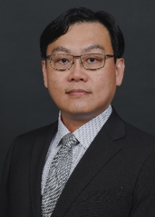
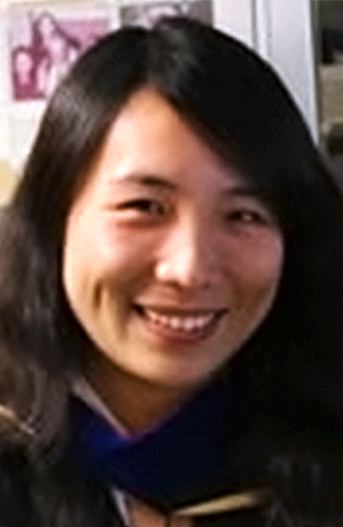
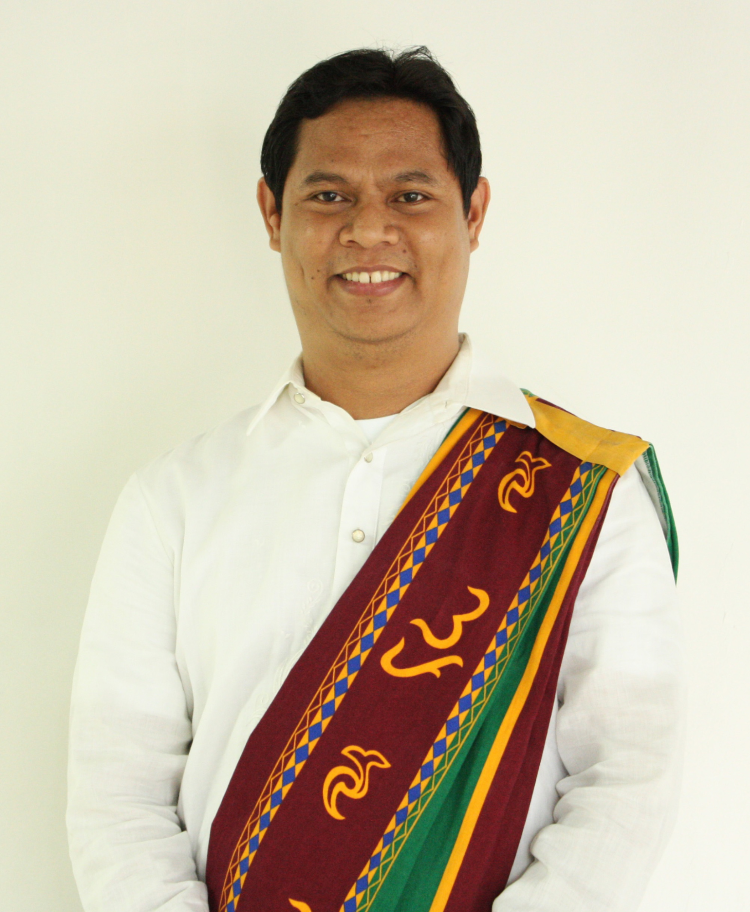

<!-- markdownlint-disable MD033 -->



## Program

<iframe src="https://drive.google.com/file/d/1tVhcbNF0nvEP7qxwLyqf5rsbtztHgK7V/preview" width="100%" height="480"></iframe>

## Speakers

### Day 1: Prof. Kong Aik Lee

<table>
  <tr>
    <td style="width: 150px; vertical-align: top;">
      
    </td>
    <td style="vertical-align: top;">
      <h3>Who Is Speaking, and Is It Real? Metrics and Data for Speaker Verification and Deepfake Detection</h3>
      
<strong>Prof. Kong Aik Lee</strong> 
      Hong Kong Polytechnic University, ISCA distinguished lecturer

      
<strong>Abstract:</strong> 
      Our voices are increasingly used to authenticate who we are, from banking and call centres to smart devices and electric vehicles. At the same time, advances in speech synthesis and voice conversion mean we can no longer assume a realistic-sounding voice comes from a human speaker at all. This talk addresses the two questions at the heart of secure voice biometrics: who is speaking, and is it real? We begin with the fundamentals of speaker verification and deepfake detection, exploring modern deep learning architectures alongside our work on modelling uncertainty in voice representations and designing countermeasures that generalize to unseen attacks. We then turn to evaluation, presenting our tandem metrics, which assess speaker verification and spoofing countermeasures as an integrated pipeline rather than as isolated components. Next, we examine the data collection and curation strategies that underpin progress in the field, from controlled recordings to crowdsourced data, drawing on the benchmark corpora and international challenges we have helped build. Finally, we close with ongoing work on future benchmarks, focusing on the risk of train-test data overlap in the era of large models and the emerging convergence of related speech tasks.

      
<strong>Bio:</strong> 
      Kong Aik LEE is currently an Associate Professor at The Hong Kong Polytechnic University since 2023. He received his Ph.D. degree from Nanyang Technological University, Singapore, in 2006. Following his graduation, he joined the Institute for Infocomm Research, Singapore, where he worked as a Research Scientist and concurrently served as a Strategic Planning Manager. From 2018 to 2020, he was a Senior Principal Researcher at the Data Science Research Laboratories, NEC Corporation, Tokyo, Japan. From 2020 to 2023, he served as a Principal Scientist and Group Leader at the Agency for Science, Technology and Research (A*STAR), Singapore, while concurrently holding an appointment as an Associate Professor at the Singapore Institute of Technology. Prof. Lee is a recipient of the Singapore IES Prestigious Engineering Achievement Award (2013) and the IEEE ICME Outstanding Service Award (2020). He has served on the Editorial Board of Computer Speech and Language (Elsevier) since 2016 and was an Associate Editor for the IEEE/ACM Transactions on Audio, Speech, and Language Processing from 2017 to 2021. He was the General Chair of the Speaker Odyssey 2020 Workshop, and an elected member of the IEEE Speech and Language Processing Technical Committee (2019-2021, 2022-2024). He currently serves as a Senior Associate Editor for the IEEE Signal Processing Letters, Chair of the ISCA Speaker and Language Characterization (SpLC) SIG, ISCA Lead Area Chair (Speaker and Language Characterization, 2026–2027), and is an ISCA Distinguished Lecturer.

    </td>
  </tr>
</table>

### Day 2: Prof. Yao Yao

<table>
  <tr>
    <td style="width: 150px; vertical-align: top;">
      
    </td>
    <td style="vertical-align: top;">
      <h3>Hearing creaky voice in Mandarin Chinese and English: Shared and language-specific patterns in bilingual social perception</h3>
      
<strong>Prof. Yao Yao</strong> 
      Hong Kong Polytechnic University

      
<strong>Abstract:</strong> 
      Recent sociophonetic research has highlighted voice quality as an important cue to social meanings related to gender, affect, and persona. However, most studies have focused on monolingual listeners, particularly speakers of English. In North American English, for example, creaky voice is commonly associated with young women and often evaluated negatively. Previous research on Mandarin Chinese, by contrast, has found more negative evaluations of creaky voice when produced by male talkers. These findings suggest that the gendered social meanings of creaky voice differ across languages, raising the question of how bilingual listeners evaluate this voice quality in each of their languages.
       
      We investigated this question in three groups of Mandarin–English bilinguals with distinct language backgrounds: Mandarin-first sequential bilinguals who learned English as a second language, English-first late learners of Mandarin, and heritage speakers of Mandarin raised in the United States. All the participants completed a social perception task, where they heard and evaluated 12–14 talkers in each language, balanced by gender and voice quality, on 20 personal characteristics.
       
      The results revealed both shared and language-specific patterns of social evaluation across the two languages within each bilingual group. These findings suggest that bilingual listeners may carry social meanings associated with a particular voice quality across languages while also maintaining language-specific associations. The extent and nature of these cross-linguistic similarities and differences varied across bilingual profiles. We discuss the implications of these findings for models of bilingual speech processing and the representation of sociophonetic knowledge.

      
<strong>Bio:</strong> 
      Yao Yao is an Associate Professor in the Department of Language Science and Technology at The Hong Kong Polytechnic University. Her primary research interests are phonetics and psycholinguistics. Her recent projects examine bilingual speech perception and production, the influence of social information on speech prediction, the social perception of voice quality in Mandarin Chinese, and speech perception in human–computer interaction. She currently serves as an Associate Editor of Applied Psycholinguistics and Laboratory Phonology and as an Editorial Board member of the Journal of Phonetics.

    </td>
  </tr>
</table>

### Day 3: Prof. Rhandley Cajote

<table>
  <tr>
    <td style="width: 150px; vertical-align: top;">
      
    </td>
    <td style="vertical-align: top;">
      <h3>From Voices to Tokens: Building Language Technologies for Philippine Languages</h3>
      
<strong>Prof. Rhandley Cajote</strong> 
      University of the Philippines

      
<strong>Abstract:</strong> 
      The Philippines is home to more than a hundred native languages, yet many remain under-resourced in the development of contemporary speech and language technologies. Over the past decades, efforts at the University of the Philippines have sought to address different stages of this resource gap—from the collection of speech, to the development of large-scale text corpora, and more recently, to the study of how Philippine languages are represented within neural language models.
       
      This keynote traces this progression through several initiatives in Philippine language resource development. The Philippine Languages Database was created as a multilingual speech corpus covering ten Philippine languages, with more than 400+ hours of read and spontaneous speech collected across multiple domains and speaker populations. The resource was designed to support the development of technologies mainly automatic speech recognition, text-to-speech synthesis, phoneme transcription, and voice conversion, while also contributing to broader language documentation and research. These efforts were subsequently complemented by the development of increasingly large text resources, including the MARITES corpus, which continues to collect Filipino-language material for natural language processing research.
       
      As language technology moves from corpus construction toward increasingly capable pretrained and large language models, however, the availability of data is only one part of the problem. How a language is represented computationally can itself affect how effectively limited linguistic resources are used. Recent work on Filipino tokenization investigates this issue by several tokenization methods and generative models across multiple Filipino NLP tasks. The results show that differences in segmentation and morphological preservation do not translate uniformly into downstream performance; rather, tokenizer effectiveness depends on the target task, vocabulary size, and model architecture.
       
      The work therefore suggests that, particularly for resource-constrained languages, progress cannot depend solely on scaling data and model size, that language representation and model design must also be considered carefully.

      
<strong>Bio:</strong> 
      Rhandley D. Cajote is a Professor at the Electrical and Electronics Engineering Institute, University of the Philippines Diliman, where he heads the Digital Signal Processing Laboratory. He received his BS and MS degrees in Electrical Engineering from the University of the Philippines Diliman and his PhD in Electrical Engineering from Chulalongkorn University, Thailand. His research interests spans digital signal processing, machine learning, image processing and video communications, and speech and language technologies. Over the years, he has led and participated in research initiatives on Philippine language technologies, including the development of speech and text resources for Filipino and other Philippine languages. His work has included the Philippine Languages Database, computational language-resource development, and more recent research on natural language processing and language-model representations for Filipino. His current research interests include machine learning and AI systems, and the development of speech and language technologies for underresourced Philippine languages.

    </td>
  </tr>
</table>
